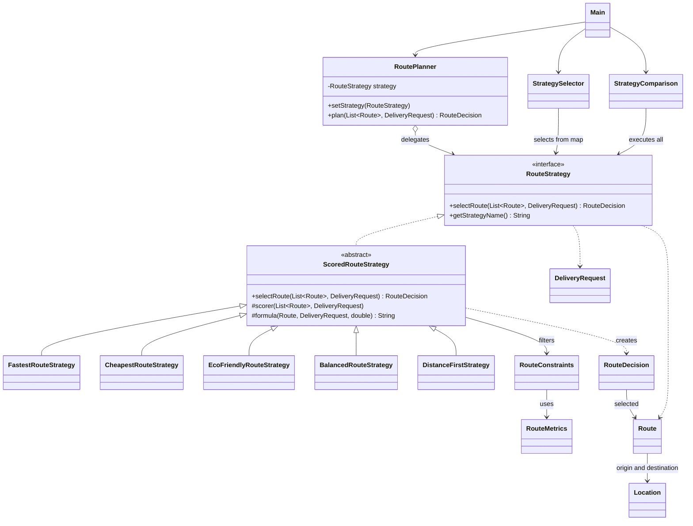
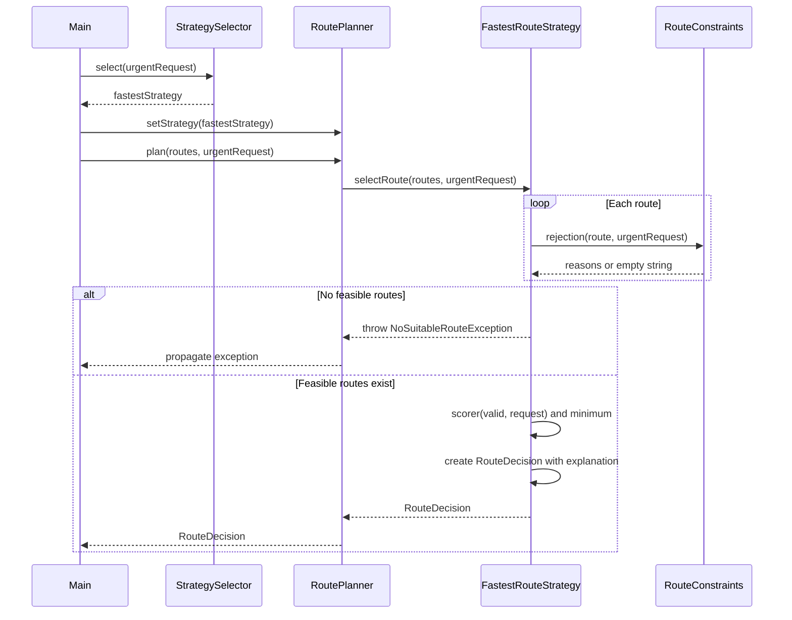

# Smart Delivery and Route Optimization Engine

Assignment 5 implementation in Java 17. Five interchangeable strategies select a route from eight candidates while respecting hard constraints. In the demonstration, Fastest selects R2, Cheapest selects R3, Eco selects R4, Balanced selects R8, and DistanceFirst selects R5.

## Build and Run

Requirements: JDK 17 or later and Maven 3.8 or later.

```sh
mvn clean test package
java -jar target/smart-delivery-1.0.0.jar
```

Production sources are in `src/main/java/delivery`; tests are in `src/test/java/delivery`. See the actual [console output](docs/example-output.txt) and [test results](docs/test-results.txt).

## Architecture and the Strategy Pattern

Strategy allows the selection criteria to change without adding algorithm selection branches to the planner. The Context is `RoutePlanner`: it holds a `RouteStrategy` reference and delegates planning to it. The `RouteStrategy` interface defines `selectRoute` and `getStrategyName`. It returns a `RouteDecision` instead of a single `Route` so that the result includes the score, final time, total cost, explanation, and rejection reasons.

The concrete strategies are `FastestRouteStrategy`, `CheapestRouteStrategy`, `EcoFriendlyRouteStrategy`, `BalancedRouteStrategy`, and `DistanceFirstStrategy`. The shared `ScoredRouteStrategy` template validates input, filters routes through `RouteConstraints`, obtains a scoring function, and selects the minimum score. Ties are resolved by the lexicographically smallest route ID. An empty candidate list or the absence of feasible routes raises `NoSuitableRouteException`. Null inputs and invalid values are explicitly rejected.

This is Strategy because route selection behavior is encapsulated in polymorphic objects. The Context does not inspect algorithm names or concrete types. The priority condition in the surcharge calculation represents a business formula rather than algorithm selection.

## Formulas and Hard Constraints

All hard constraints are applied before scoring: availability, total cost within budget, final time within the deadline, emissions within the limit, and absence from the prohibited route ID set. Boundaries are inclusive. Filtering and ranking use the same cost and time calculations.

- Final time = estimatedMinutes + trafficPenaltyMinutes + weatherPenaltyMinutes. Fastest minimizes this final time.
- Total cost = baseCost + distanceKm × costPerKm + surcharge + additionalFees. The surcharge is 500 for URGENT and 0 for other priorities. Monetary amounts use arbitrary currency units.
- Eco score = carbonEmission × emissionWeight + distanceKm × distanceWeight. Default weights are 0.9 and 0.1. Emissions are measured in kg of CO2 and distance in km. This is a heuristic score rather than a physical quantity. The formula belongs inside Eco because it defines environmental ranking. Weights must be finite and nonnegative, and cannot both be zero.
- Balanced score = wt × normalizedTime + wc × normalizedCost + wd × normalizedDistance + we × normalizedEmission. Each criterion uses min-max normalization over feasible candidates: `(value − min)/(max − min)`. If max equals min, the normalized value is 0. Default weights are 0.4, 0.3, 0.1, and 0.2. They must be finite, nonnegative, and sum to 1 within a tolerance of 1e-9.
- DistanceFirst minimizes distance among feasible routes.

For R8 under the standard request, the Balanced score is 0.4 × 11/26 + 0.3 × 1500/4000 + 0.1 × 3/12 + 0.2 × 1/4.5 = 0.3511752137. A test verifies this result using an independently specified arithmetic expression.

## Runtime Switching and Automatic Selection

`Main` creates one `RoutePlanner`, initially uses Fastest, and then calls `setStrategy` three times to select Cheapest, Eco, and Balanced. `StrategyComparison` runs all five strategies for the same request. If no route is suitable, it records a separate failure for each algorithm.

`StrategySelector` receives an immutable map from priorities to strategies: URGENT → Fastest, ECONOMY → Cheapest, ECO → Eco, and STANDARD → Balanced. A STANDARD request with ecoPreferred selects Eco. An URGENT request retains its urgency even when ecoPreferred is true. An incomplete configuration is detected when a missing mapping is requested. Strategy determines **how** to select a route; the Selector determines **which strategy** to use. The map accepts alternative implementations, but adding a new priority requires updating the enum. More complex business conditions would require an ordered collection of selection rules.

Different requests can change the result of the same strategy: Fastest selects R2 with a budget of 10000, but R4 with a budget of 3000. The unavailable R7 can never win.

## Extension and SOLID Principles

To add a strategy, implement `RouteStrategy` or extend `ScoredRouteStrategy`, then register an instance in the application composition code or comparison list. No Context changes are required. The separate commit `Add fifth distance strategy without changing existing production classes` adds only `DistanceFirstStrategy.java`. A later commit integrates it into the demonstration.

SRP: the planner delegates; strategies score; the Selector chooses an algorithm; Constraints checks feasibility; Metrics calculates shared measurements. OCP: the fifth strategy was added without changing the Context or existing algorithms. DIP: RoutePlanner depends on the RouteStrategy interface. The shared base class also uses Template Method for the reusable filtering and scoring process, complementing Strategy.

Strategy and Bridge both use composition. Here, Strategy replaces one route selection algorithm at runtime. Bridge would separate two independently evolving hierarchies, such as delivery service types and map providers. The previous assignment was not provided, so this comparison concerns the patterns rather than any unavailable previous implementation.

## Current Limitations

The application selects from predefined routes rather than finding paths in a road graph. All candidates are assumed to belong to the same delivery; request origin and destination are not separately checked. Traffic and weather penalties are static. Money uses double; real payment calculations require BigDecimal and an explicit currency. Balanced normalization depends on the feasible candidate set. RoutePlanner is not designed for concurrent use while changing its strategy. Criteria and explanations use a simple numeric model. There is no API, database, or map integration.

## Verification and Git History

All 28 JUnit Jupiter tests passed. Coverage includes all strategies, three runtime switches, selector mappings, ecoPreferred, budget, deadline, emissions, prohibited routes, unavailable routes, empty input, no feasible result, invalid weights, negative distance, null input, duplicate IDs, exact constraint boundaries, score ties, degenerate normalization, and strategy comparison.

The verification environment contains a Java 17 runtime without javac or Maven. Sources were compiled with Eclipse ECJ 3.37.0 using `-17`; tests were executed with JUnit Platform Console Standalone 1.10.2. The Maven command above is provided for a normal JDK installation but was not executed in this environment. Actual execution results are included; no Maven execution results are claimed.

The archive includes Git history. Commits represent sequential implementation stages in this session and do not simulate a week of development. Run `git log --oneline` to inspect them. The commit author is a technical placeholder; configure your own name and email before making future commits.

## UML Class Diagram



## UML Sequence Diagram

`FastestRouteStrategy` inherits the selectRoute implementation from ScoredRouteStrategy.



## Submission

This README serves as the report allowed by the assignment requirements (README or PDF). GitHub publication and Moodle submission have not been performed. After extracting the project, create an empty public repository and run:

```sh
git remote add origin https://github.com/YOUR_USERNAME/smart-delivery.git
git branch -M main
git push -u origin main
```

Submit the public repository link and README in Moodle according to the instructor's requirements. Review the formulas, tests, and UML diagrams before the individual defense.
